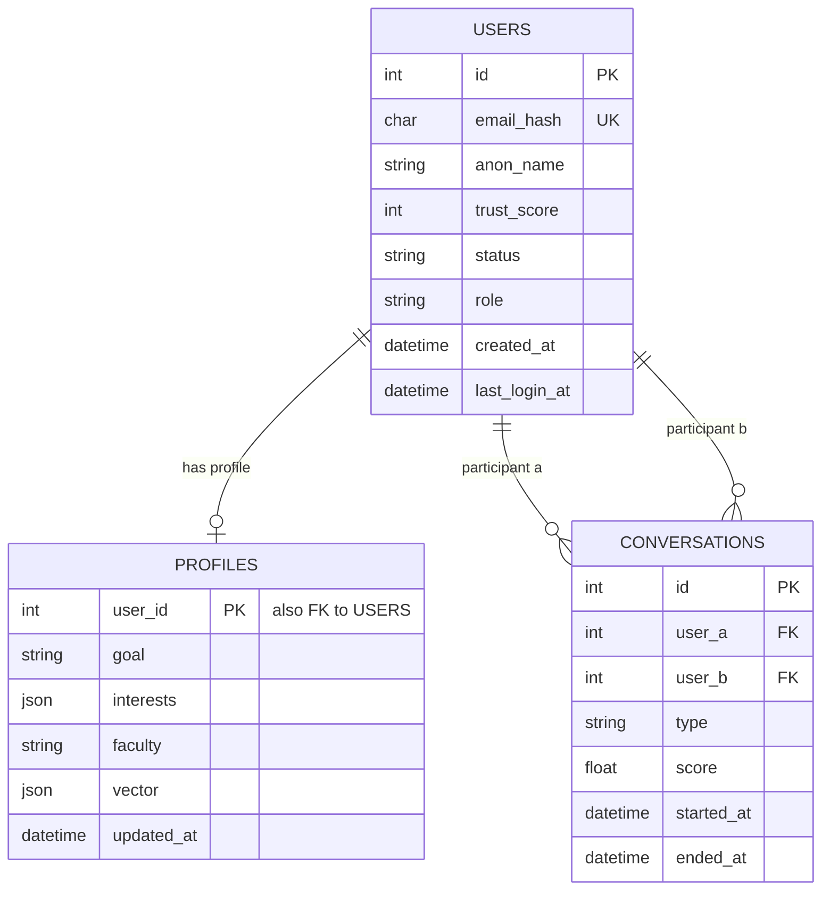

# Data Architecture & Persistence Layer

The current backend defines three SQLAlchemy entities in MySQL, with Alembic
configured for schema changes and Redis planned for ephemeral queues and chat
transport. Questionnaire v2, catalog, and report/moderation entities are
documented as proposed work and are not present in the current ORM yet.

## Database Configuration

| Service/Module | DB Type | Profile | Driver | Connection | Migration Tool |
|---|---|---|---|---|---|
| Backend relational data | MySQL | Local Docker / Aiven target | SQLAlchemy async with aiomysql | `DATABASE_URL` from environment | Alembic |
| Backend ephemeral state | Redis | Local Docker / production provider pending | redis-py asyncio planned | `REDIS_URL` from environment | Not applicable |

SQLAlchemy uses async sessions and `pool_pre_ping`; schema is managed by Alembic.
No repository-specific seed data or repository interfaces are present. Database
connectivity and migration against a running MySQL instance have not yet been
verified.

## Data Ownership per Service

| Service | Tables Owned | ORM Framework | Caching | Notes |
|---|---|---|---|---|
| FastAPI backend | `users`, `profiles`, `conversations` | SQLAlchemy 2.0 async | Redis is planned for matching queue and ephemeral chat buffer | Current entity models exist; API and repository layers are not implemented |

Planned, not yet implemented: `faculties`, `majors`, `reports`,
`report_evidence`, `moderation_results`, `trust_events`, `blocks`, and
`appeals`.

## Entity Model

The diagram reflects the current ORM tables. The profile's `interests` and
`vector` columns are legacy fields targeted for replacement by the
questionnaire fields in [db/schema.md](../../../../../db/schema.md).

<!-- mermaid-checked: every attribute is `<type> <name> [<key>] ["<description>"]` with at most one of PK/FK/UK, no \n in descriptions, no {} in descriptions, every relationship label is double-quoted -->

`User` and `Profile` have a one-to-one relationship; `Profile.user_id` is both
its primary key and a cascading foreign key. `Conversation` has two separately
mapped foreign-key relationships to `User`, one for each participant. Current
ORM sources are `backend/app/models/user.py`,
`backend/app/models/profile.py`, and
`backend/app/models/conversation.py`.

## Key Repository Methods

| Service | Repository | Notable Methods | Purpose |
|---|---|---|---|
| FastAPI backend | None found | None | No repository interfaces or custom database queries are implemented yet |

## Caching Strategy

Redis is part of the documented runtime design but no Redis client, queue worker,
or chat buffer implementation exists in the current backend source. The planned
matching queue caches derived profile vectors only while users wait; vectors are
not persisted in MySQL. The proposed chat buffer has a sliding 30-minute TTL and
is refreshed when a conversation ends. A valid report may copy encrypted
evidence into MySQL for at most 30 minutes after report creation; Redis TTL does
not delete that database copy, so a separate cleanup worker is required.

## Data Ownership Boundaries

The application currently has one backend and one relational database; there
are no separate service databases or cross-service data access patterns.
Redis is a separate ephemeral state store, not a source of durable application
records. ORM transactions and data access will be owned by the backend.

The planned catalog uses a `faculties` table for School/Institute/Faculty and a
`majors` table for majors under each school. The planned moderation flow adds
report and trust tables; exact target structures are described in
[db/schema.md](../../../../../db/schema.md). The only catalog source currently
approved is the HUST admissions page, but its displayed admission codes have
not been confirmed as stable major identifiers.

### Data Classification & Sensitivity

| Entity | Sensitive Fields | Classification (PII/PHI/PCI/None) | Controls in Place |
|---|---|---|---|
| `users` | `email_hash`, `anon_name`, trust/status | Pseudonymous identifier and user-linked data | Raw email is prohibited by project rules; HMAC is specified. Field encryption and masking are not configured in current code |
| `profiles` | Goal, interests, faculty, vector | User-linked preference and education data | Access control is not implemented yet; legacy `vector` is planned for removal |
| `conversations` | Participant IDs and timestamps | User-linked activity data | Message bodies are not modeled in MySQL |
| Planned `report_evidence` | Encrypted recent conversation excerpt | Sensitive user-generated content | Not implemented. Design requires encryption, `expires_at` 30 minutes after report creation, and explicit database cleanup |
