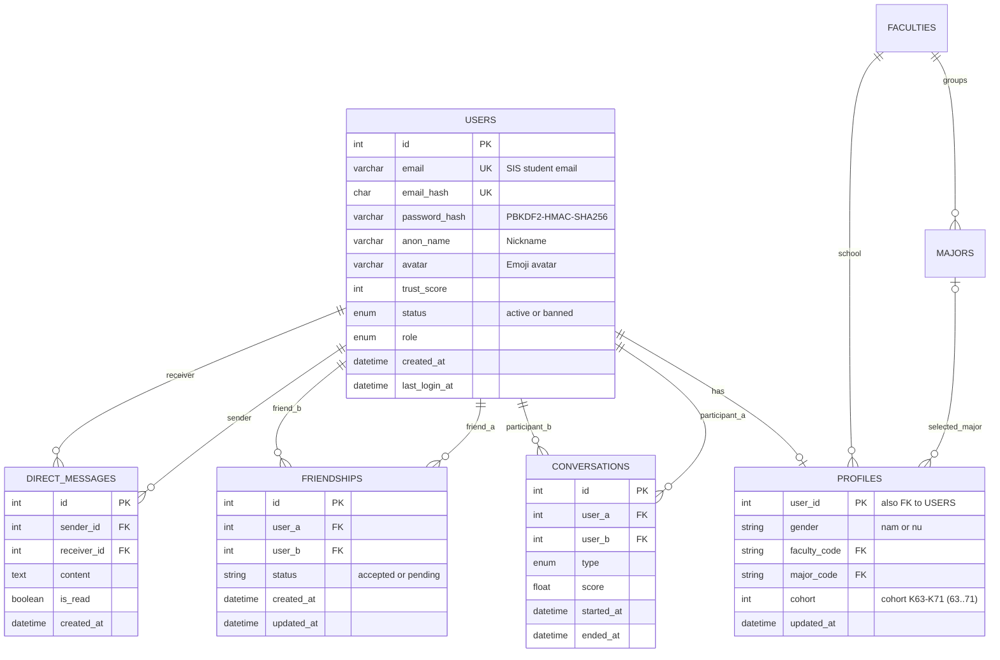

# Database Schema Design

> **Core MVP Tables**: `users`, `profiles`, `conversations`, `friendships`, and `direct_messages`.
> Profile specifications and 3-criteria mutual matching filters are documented in [docs/QUESTIONNAIRE.md](../docs/QUESTIONNAIRE.md).

## Target Relational Model

## Active Tables

### `users`

| Column | Type | Constraints / Meaning |
|---|---|---|
| `id` | `INT` | Primary Key, Auto-increment |
| `email` | `VARCHAR(191)` | Unique, student email (`@sis.hust.edu.vn`) |
| `email_hash` | `CHAR(64)` | Required, unique HMAC-SHA256 of normalized email |
| `password_hash` | `VARCHAR(255)` | Salted PBKDF2-HMAC-SHA256 hash |
| `anon_name` | `VARCHAR(50)` | User-chosen nickname |
| `avatar` | `VARCHAR(20)` | User-chosen avatar emoji (default 🦉) |
| `trust_score` | `INT` | Default `100` |
| `status` | `ENUM` | `active`, `banned`; default `active` |
| `role` | `ENUM` | `user`, `admin`; default `user` |
| `created_at` | `DATETIME` | Account creation timestamp |
| `last_login_at` | `DATETIME NULL` | Most recent login |

### `profiles`

| Column | Type | Meaning |
|---|---|---|
| `user_id` | `INT PK/FK` | Primary Key, References `users.id` (CASCADE) |
| `gender` | `VARCHAR(10)` | Gender: `nam` (Male) or `nu` (Female) |
| `faculty_code` | `VARCHAR(20)` | HUST School/Faculty code |
| `major_code` | `VARCHAR(20)` | HUST Major code from 68 catalog |
| `cohort` | `INT` | Academic cohort between K63 and K71 (63..71) |
| `updated_at` | `DATETIME` | Last profile update timestamp |

### `friendships`

| Column | Type | Constraints / Meaning |
|---|---|---|
| `id` | `INT` | Primary Key, Auto-increment |
| `user_a`, `user_b` | `INT FK` | Users in friendship; unique pair constraint |
| `status` | `VARCHAR(20)` | `accepted`, `pending`, `declined` |
| `created_at` | `DATETIME` | Created timestamp |
| `updated_at` | `DATETIME` | Last updated timestamp |

### `direct_messages`

| Column | Type | Constraints / Meaning |
|---|---|---|
| `id` | `INT` | Primary Key, Auto-increment |
| `sender_id` | `INT FK` | User who sent the message |
| `receiver_id` | `INT FK` | User who received the message |
| `content` | `TEXT` | Message text content |
| `is_read` | `BOOLEAN` | Read status |
| `created_at` | `DATETIME` | Message send timestamp |

### `conversations`

| Column | Type | Constraints / Meaning |
|---|---|---|
| `id` | `INT` | Primary Key, Auto-increment |
| `user_a`, `user_b` | `INT FK` | Room participants; distinct users |
| `type` | `ENUM` | `human`, `bot`; default `human` |
| `score` | `FLOAT NULL` | Match score |
| `started_at` | `DATETIME` | Room start timestamp |
| `ended_at` | `DATETIME NULL` | Room termination timestamp |
