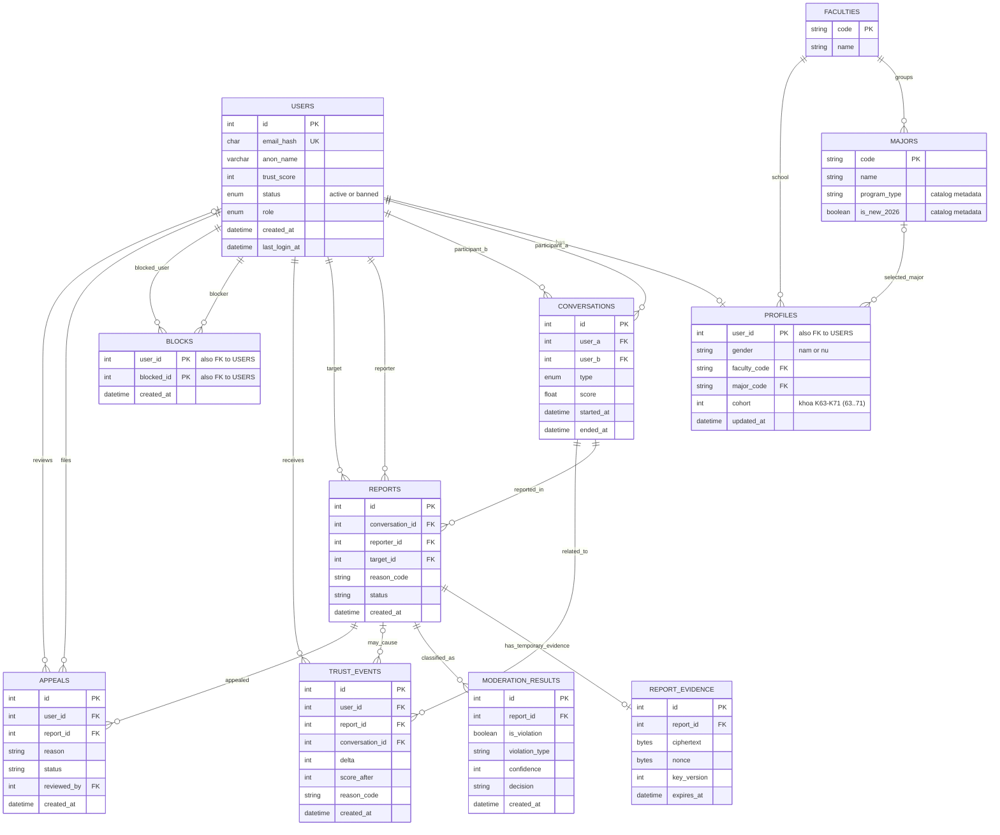

# Thiết kế schema database

> Chỉ `users`, `profiles` và `conversations` có model/migration ban đầu.
> Questionnaire v3, catalog và các bảng kiểm duyệt là schema mục tiêu, chưa
> có migration. Mã/nhãn câu hỏi lấy từ
> [docs/QUESTIONNAIRE.md](../docs/QUESTIONNAIRE.md).

## Mô hình quan hệ mục tiêu

<!-- mermaid-checked: every attribute is `<type> <name> [<key>] ["<description>"]` with at most one of PK/FK/UK, no \n in descriptions, no {} in descriptions, every relationship label is double-quoted -->

## Schema đang có

### `users`

| Cột | Kiểu | Ràng buộc / ý nghĩa |
|---|---|---|
| `id` | `INT` | Khóa chính tự tăng |
| `email_hash` | `CHAR(64)` | Bắt buộc, duy nhất; HMAC-SHA256 của email đã chuẩn hóa, không lưu email thô |
| `anon_name` | `VARCHAR(50)` | Tên ẩn danh |
| `trust_score` | `INT` | Mặc định `100` |
| `status` | `ENUM` | `active`, `banned`; mặc định `active`; ban khi `trust_score <= 0` |
| `role` | `ENUM` | `user`, `admin`; mặc định `user` |
| `created_at` | `DATETIME` | Thời gian tạo |
| `last_login_at` | `DATETIME NULL` | Đăng nhập gần nhất |

### `profiles`

Hồ sơ người dùng bắt buộc khi đăng nhập, gồm thông tin học tập và giới tính:

| Cột | Kiểu | Ý nghĩa |
|---|---|---|
| `user_id` | `INT PK/FK` | Khóa chính, liên kết `users.id` (CASCADE) |
| `gender` | `VARCHAR(10)` | Giới tính: `nam` hoặc `nu` |
| `faculty_code` | `VARCHAR(20)` | Mã Trường/Viện theo danh mục HUST |
| `major_code` | `VARCHAR(20)` | Mã ngành học theo danh mục 68 ngành HUST |
| `cohort` | `INT` | Khóa sinh viên từ K63 đến K71 (63..71) |
| `updated_at` | `DATETIME` | Thời điểm cập nhật hồ sơ |

Quy tắc ghép cặp và 3 bộ lọc cứng hai chiều được định nghĩa tại [docs/QUESTIONNAIRE.md](../docs/QUESTIONNAIRE.md).

### `conversations`

| Cột | Kiểu | Ràng buộc / ý nghĩa |
|---|---|---|
| `id` | `INT` | Khóa chính tự tăng |
| `user_a`, `user_b` | `INT FK` | Hai người tham gia; có index; không thể là cùng một user |
| `type` | `ENUM` | `human`, `bot`; mặc định `human` |
| `score` | `FLOAT NULL` | Weighted match score cuối cùng |
| `started_at` | `DATETIME` | Thời điểm bắt đầu; ghi nhận lượt ghép thành công và tính quota theo ngày Việt Nam |
| `ended_at` | `DATETIME NULL` | Đặt khi một bên kết thúc phòng; cho phép xác định quyền báo cáo |

## Danh mục School và Major

- `faculties`: 10 Trường/Viện/Khoa từ
  CSV catalog; `name` giữ nguyên tên trong dữ liệu. `code` là slug nội bộ,
  không phải mã chính thức HUST.
- `majors`: 68 chương trình, dùng đúng mã trong CSV làm `major_code`; mỗi mã
  tham chiếu đến một `faculty_code`. CSV import:
  [hust-schools-2026.csv](./seed/hust-schools-2026.csv) và
  [hust-68-nganh-2026.csv](./seed/hust-68-nganh-2026.csv).
- Lưu `program_type` và `is_new_2026` trong `majors` như metadata catalog; không
  dùng làm điều kiện matching.
- CSV chương trình là nguồn chuẩn; `python db/seed/generate_hust_catalog.py`
  kiểm tra dữ liệu và tạo lại CSV đơn vị. Catalog tổng hợp; cần đối chiếu
  TROY-IT, ED2/ED3/ED5, MS2, MI-E22 và chỉ tiêu BF-E12 trước production.
  Không crawl website hoặc tự sửa mã/tên khi import.

## Bảng kiểm duyệt và an toàn – schema mục tiêu

| Bảng | Cột chính | Mục đích và giới hạn dữ liệu |
|---|---|---|
| `reports` | `conversation_id`, `reporter_id`, `target_id`, `reason_code`, `status`, `created_at` | Chỉ người tham gia mới báo cáo người còn lại; chỉ tạo sau khi conversation kết thúc và trong 30 phút |
| `report_evidence` | `report_id`, `ciphertext`, `nonce`, `key_version`, `expires_at` | Bằng chứng mã hóa; hết hạn 30 phút sau khi tạo báo cáo; worker dọn dữ liệu hết hạn |
| `moderation_results` | `report_id`, `is_violation`, `violation_type`, `confidence`, `decision` | Giai đoạn đầu chỉ thu thập dữ liệu; placeholder `50` không đổi trust score |
| `trust_events` | `user_id`, `report_id`, `conversation_id`, `delta`, `score_after`, `reason_code` | Nhật ký thay đổi điểm uy tín |
| `blocks` | `user_id`, `blocked_id`, `created_at` | Cặp khóa chính ngăn chặn hai chiều khi ghép |
| `appeals` | `user_id`, `report_id`, `reason`, `status`, `reviewed_by` | Khiếu nại kết quả xử lý; trạng thái/luồng duyệt cần đặc tả ở task kiểm duyệt |

Tin nhắn không được lưu thành lịch sử chat. Mỗi conversation có buffer Redis
gồm tin nhắn của cả hai phía, tối đa 1 MiB; khi đầy, xóa tin cũ nhất trước.
Buffer có TTL được làm mới khi chat còn hoạt động; đặt TTL 30 phút sau khi
conversation kết thúc, đồng thời dọn key của phòng stale. Người
tham gia có 30 phút kể từ `ended_at` để report; report hợp lệ snapshot phần còn
lại trong buffer vào `report_evidence` đã mã hóa, xóa 30 phút sau khi tạo
report. Redis Pub/Sub và buffer có vòng đời riêng, không phải kho lưu trữ lâu
dài. Không nhận report thành công nếu không lưu được snapshot evidence.
