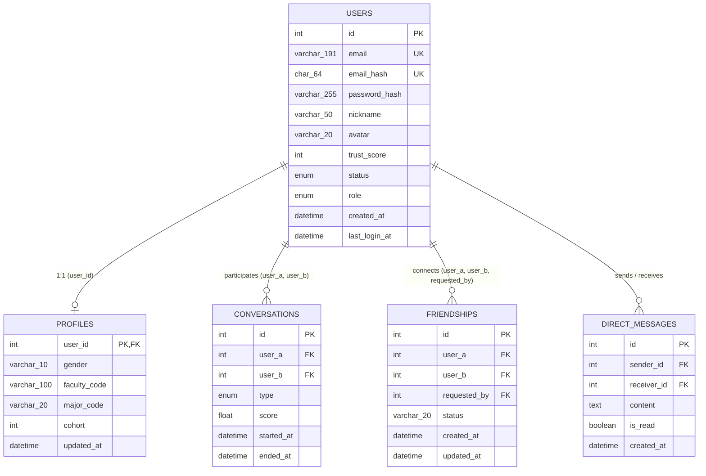

# Database Schema (MVP)

Tài liệu này mô tả chính xác 5 bảng dữ liệu trong MySQL 8.0 của dự án **HUST Match**, đồng bộ 100% với `backend/app/models/` và các bản Alembic migration từ `0001` đến `0004`.

> [!NOTE]
> Danh mục 68 ngành đào tạo và Trường/Viện/Khoa của HUST không lưu thành bảng trong MySQL mà được đọc trực tiếp từ file CSV `db/seed/hust-68-nganh-2026.csv` qua `backend/app/services/catalog.py`.

## Sơ đồ Thực thể Liên kết (Mermaid ERD)

---

## Chi tiết các bảng

### 1. `users`
Lưu tài khoản sinh viên HUST (`@sis.hust.edu.vn`), thông tin hiển thị ẩn danh và trạng thái uy tín.
- `id`: `INT AUTO_INCREMENT PRIMARY KEY`
- `email`: `VARCHAR(191) NULL UNIQUE`, có index `ix_users_email` (chỉ hiển thị cho đối phương khi đã kết bạn `accepted`).
- `email_hash`: `CHAR(64) NOT NULL UNIQUE` (`uq_users_email_hash`) — HMAC-SHA256 của email đã chuẩn hóa với `EMAIL_HASH_SECRET`.
- `password_hash`: `VARCHAR(255) NULL` — mật khẩu băm PBKDF2-SHA256 (`pbkdf2_sha256$260000$<salt>$<digest>`).
- `nickname`: `VARCHAR(50) NOT NULL` — biệt danh tự chọn hoặc sinh ngẫu nhiên (VD: `Red Panda #481`).
- `avatar`: `VARCHAR(20) NOT NULL DEFAULT '🦉'` — 1 trong 11 emoji linh vật thú.
- `trust_score`: `INT NOT NULL DEFAULT 100` — quyết định hạn mức ghép đôi mỗi ngày (`>=90`: không giới hạn, `70..89`: 5, `50..69`: 3, `1..49`: 1, `<=0`: khóa ghép đôi).
- `status`: `ENUM('active', 'banned') NOT NULL DEFAULT 'active'`
- `role`: `ENUM('user', 'admin') NOT NULL DEFAULT 'user'`
- `created_at`: `DATETIME NOT NULL DEFAULT CURRENT_TIMESTAMP`
- `last_login_at`: `DATETIME NULL`

### 2. `profiles`
Lưu hồ sơ cá nhân và 3 tiêu chí cứng phục vụ thuật toán ghép đôi 2 chiều.
- `user_id`: `INT PRIMARY KEY`, `FK -> users.id ON DELETE CASCADE`
- `gender`: `VARCHAR(10) NOT NULL` (`'male'` | `'female'`)
- `faculty_code`: `VARCHAR(100) NOT NULL` — mã/slug Trường, Viện, Khoa (được suy ra tự động từ `major_code` theo catalog CSV; đã mở rộng lên 100 ký tự ở migration `0004`).
- `major_code`: `VARCHAR(20) NOT NULL` — mã ngành đào tạo HUST (VD: `IT1`, `IT2`, `EE2`, `ME1`).
- `cohort`: `INT NOT NULL` — khóa học từ `63` đến `71` (tương ứng `K63`–`K71`).
- `updated_at`: `DATETIME NOT NULL DEFAULT CURRENT_TIMESTAMP ON UPDATE CURRENT_TIMESTAMP`

### 3. `conversations`
Lưu phiên ghép đôi ẩn danh giữa 2 người dùng (không lưu nội dung tin nhắn trong MySQL).
- `id`: `INT AUTO_INCREMENT PRIMARY KEY`
- `user_a`: `INT NOT NULL`, `FK -> users.id`, có index `ix_conversations_user_a`
- `user_b`: `INT NOT NULL`, `FK -> users.id`, có index `ix_conversations_user_b`
- `type`: `ENUM('human', 'bot') NOT NULL DEFAULT 'human'` (trong ORM Python đặt tên thuộc tính là `conversation_type`).
- `score`: `FLOAT NULL`
- `started_at`: `DATETIME NOT NULL DEFAULT CURRENT_TIMESTAMP`
- `ended_at`: `DATETIME NULL` (`NULL` nghĩa là phòng đang hoạt động; có giá trị khi 1 bên bấm End Chat hoặc khi kết bạn thành công chuyển sang DM).
- **Ràng buộc**: `CHECK (user_a <> user_b)` (`ck_conversations_distinct_users`).

### 4. `friendships`
Lưu trạng thái kết bạn 2 chiều phát sinh từ phòng chat ẩn danh.
- `id`: `INT AUTO_INCREMENT PRIMARY KEY`
- `user_a`: `INT NOT NULL`, `FK -> users.id ON DELETE CASCADE` (luôn lưu `min(uid1, uid2)`).
- `user_b`: `INT NOT NULL`, `FK -> users.id ON DELETE CASCADE` (luôn lưu `max(uid1, uid2)`).
- `requested_by`: `INT NULL`, `FK -> users.id ON DELETE CASCADE` (thêm ở migration `0003` — lưu ID người chủ động bấm kết bạn để ngăn tự chấp nhận lời mời của chính mình).
- `status`: `VARCHAR(20) NOT NULL DEFAULT 'accepted'` (`'pending'` | `'accepted'` | `'declined'`).
- `created_at`: `DATETIME NOT NULL DEFAULT CURRENT_TIMESTAMP`
- `updated_at`: `DATETIME NOT NULL DEFAULT CURRENT_TIMESTAMP ON UPDATE CURRENT_TIMESTAMP`
- **Ràng buộc & Index**: `UNIQUE (user_a, user_b)` (`uq_friendships_user_a_user_b`), `ix_friendships_user_a`, `ix_friendships_user_b`.

### 5. `direct_messages`
Lưu lịch sử tin nhắn vĩnh viễn giữa những người dùng đã kết bạn (`friendships.status = 'accepted'`).
- `id`: `INT AUTO_INCREMENT PRIMARY KEY` (dùng làm con trỏ `before_id` khi phân trang cursor).
- `sender_id`: `INT NOT NULL`, `FK -> users.id ON DELETE CASCADE`, có index `ix_direct_messages_sender_id`
- `receiver_id`: `INT NOT NULL`, `FK -> users.id ON DELETE CASCADE`, có index `ix_direct_messages_receiver_id`
- `content`: `TEXT NOT NULL` (tối đa 1000 ký tự).
- `is_read`: `BOOLEAN NOT NULL DEFAULT FALSE`
- `created_at`: `DATETIME NOT NULL DEFAULT CURRENT_TIMESTAMP`, có index `ix_direct_messages_created_at`
