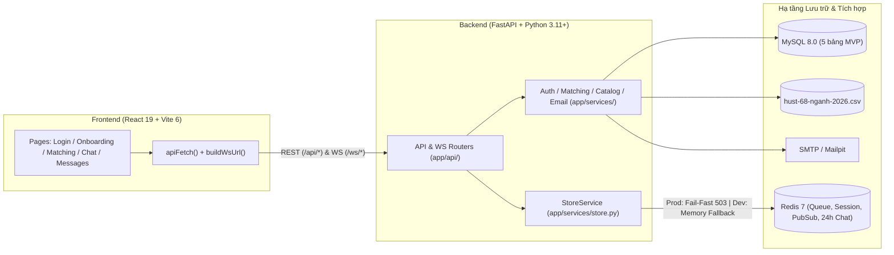

# Kiến trúc Hệ thống & Hợp đồng Kỹ thuật (Architecture & Contracts)

Tài liệu này là **Single Source of Truth** về sơ đồ kiến trúc, danh mục REST/WebSocket Endpoints và quy ước khóa Redis (`hust:v1:*`) của dự án **HUST Match**.

## 1. Sơ đồ Kiến trúc Tổng thể

---

## 2. Danh mục REST & WebSocket Endpoints Hiện hành

> [!NOTE]
> Backend gắn các router ở cả `/api/<path>` và `/<path>` để tương thích với cả gọi trực tiếp lẫn khi qua Vite dev proxy.

| Nhóm | Phương thức & Đường dẫn | Mục đích & Hợp đồng Dữ liệu chính |
| :--- | :--- | :--- |
| **Health** | `GET /live` | Liveness probe nhẹ, luôn trả `200 {"status": "live"}`. |
| **Health** | `GET /health` | Readiness probe kiểm tra `SELECT 1` (MySQL) và `PING` (Redis); trả `503` nếu dịch vụ bắt buộc ngừng phản hồi. |
| **Auth** | `POST /auth/request-register-otp` | Kiểm tra đuôi `@sis.hust.edu.vn`, rate-limit IP/Email, chống dò tài khoản (anti-enumeration), gửi OTP 6 số (TTL 5 phút, cooldown 60s). |
| **Auth** | `POST /auth/register` | Xác minh OTP (`purpose="register"`), băm mật khẩu PBKDF2-SHA256, tạo user, cấp JWT `HttpOnly` cookie + lưu session `jti`. |
| **Auth** | `POST /auth/login` | Đăng nhập bằng Email + Mật khẩu (giới hạn 10 lần/15 phút), cấp JWT cookie + lưu session `jti`. |
| **Auth** | `POST /auth/request-reset-otp` | Gửi OTP đặt lại mật khẩu (`purpose="reset"`) với anti-enumeration. |
| **Auth** | `POST /auth/reset-password` | Xác minh OTP `reset`, đổi mật khẩu, **thu hồi toàn bộ session cũ (`revoke_user_sessions`)** và cấp session mới. |
| **Auth** | `GET /auth/me` | Trả thông tin user hiện tại, cờ `has_profile` và dữ liệu `profile`. |
| **Auth** | `POST /auth/logout` | Thu hồi `jti` hiện tại trong Redis và xóa cookie `access_token`. |
| **Profile** | `GET /profile/catalog` | Trả danh sách 68 ngành đào tạo + Trường/Viện từ `hust-68-nganh-2026.csv`. |
| **Profile** | `GET /profile/me` | Lấy hồ sơ cá nhân (`gender`, `faculty_code`, `major_code`, `cohort`). |
| **Profile** | `POST /profile` | Tạo/cập nhật hồ sơ, tự suy ra `faculty_code` chuẩn từ `major_code`, cập nhật `nickname` và `avatar`. |
| **Match** | `GET /match/active-room` | Kiểm tra xem user có đang ở trong phòng chat ẩn danh nào chưa kết thúc (`ended_at IS NULL`) không. |
| **Match** | `POST /match/join` | Kiểm tra hạn mức `trust_score`/ngày, quét hàng đợi thỏa mãn 3 tiêu chí 2 chiều, dùng Lua Script giữ chỗ nguyên tử hoặc đưa vào hàng đợi chờ 60s. |
| **Match** | `GET /match/status` | Polling trạng thái ghép đôi (`waiting`, `matched` kèm `room_id`, `not_found` khi hết 60s, hoặc `idle`). |
| **Match** | `POST /match/leave` | Rời hàng đợi ghép đôi và xóa kết quả tạm. |
| **Chat** | `GET /conversations/{room_id}/init` | **API khởi tạo gộp (1 round-trip)**: trả đồng thời `meta` (`opponent.email = None`), `history` (lịch sử 24h từ Redis) và `has_more`. |
| **Chat** | `GET /conversations/{room_id}/meta` | Lấy metadata phòng chat ẩn danh (không bao giờ lộ email thật). |
| **Chat** | `GET /conversations/{room_id}/history` | Lấy lịch sử chat ẩn danh phân trang cursor theo `before_timestamp` và `limit`. |
| **Chat** | `POST /conversations/{room_id}/end` | Đóng phòng chat (`ended_at = NOW()`), phát sự kiện `ended`, lưu vào lịch sử Redis và hủy task Pub/Sub của phòng sau 0.5s. |
| **Chat** | `WS /ws/{room_id}` | WebSocket phòng chat ẩn danh: kiểm tra thành viên & `ended_at is None` trước khi chiếm WS slot; hỗ trợ `message`, `friend_request`, `friend_response`. |
| **DM** | `GET /friends` | Lấy danh sách bạn bè (`accepted`) kèm tin nhắn mới nhất bằng 1 truy vấn SQL Window Function `ROW_NUMBER() OVER (PARTITION BY partner_id ...)`. |
| **DM** | `GET /messages/{friend_id}` | Lấy lịch sử tin nhắn bạn bè từ MySQL theo phân trang cursor `before_id` và `limit`. |
| **DM** | `WS /ws/direct/{friend_id}` | **Kênh duy nhất gửi/nhận tin nhắn bạn bè realtime**: kiểm tra `Friendship.status == 'accepted'` trước khi chiếm WS slot, lưu vào bảng `direct_messages` và phát qua Pub/Sub DM. |

---

## 3. Quy ước Khóa Redis (`hust:v1:*`) & Vòng đời Dữ liệu

| Mẫu Key Redis | Kiểu dữ liệu | TTL | Mục đích sử dụng |
| :--- | :---: | :---: | :--- |
| `hust:v1:ratelimit:ip:{ip}` | String (Counter) | `60s` | Giới hạn 20 yêu cầu OTP / phút trên mỗi địa chỉ IP. |
| `hust:v1:ratelimit:email:{email_hash}` | String (Counter) | `300s` | Giới hạn 5 yêu cầu OTP / 5 phút trên mỗi email HMAC. |
| `hust:v1:ratelimit:login:email:{email_hash}` | String (Counter) | `900s` | Giới hạn 10 lần thử đăng nhập sai / 15 phút; xóa ngay khi đăng nhập đúng. |
| `hust:v1:otp:{purpose}:{email_hash}` | JSON String | `300s` | Lưu `{"hash": "<hmac>", "attempts": 0..5}` tách biệt theo `purpose` (`register` hoặc `reset`). |
| `hust:v1:cooldown:{purpose}:{email_hash}` | String (`"1"`) | `60s` | Chặn bấm gửi lại mã OTP liên tục trong 60 giây. |
| `hust:v1:auth:session:{jti}` | String (`user_id`) | `86400s` | Allowlist phiên đăng nhập JWT đang hoạt động. |
| `hust:v1:auth:user_sessions:{user_id}` | ZSET (`jti -> exp`) | `86400s` | Danh sách toàn bộ `jti` của 1 user để thu hồi đồng loạt khi đổi mật khẩu. |
| `hust:v1:ws:user:{user_id}` | String (Counter) | `86400s` | Đếm số kết nối WebSocket đồng thời của 1 user (tối đa `3`). |
| `hust:v1:ws:ip:{client_ip}` | String (Counter) | `86400s` | Đếm số kết nối WebSocket đồng thời từ 1 IP (tối đa `10`). |
| `hust:v1:match:queue:set` | Set (`user_id`) | — | Tập hợp ID các ứng viên đang chờ trong hàng đợi ghép đôi. |
| `hust:v1:match:queue:entry:{user_id}` | JSON String | `65s` | Hồ sơ + tiêu chí lọc + `attempt_id` + `joined_at` của người đang chờ (timeout ở 60s). |
| `hust:v1:match:result:{user_id}` | JSON String | `120s` | Lưu kết quả ghép đôi thành công (`room_id`, `partner`, `attempt_id`) cho client đang polling. |
| `hust:v1:match:terminal:{user_id}` | JSON String | `120s` | Lưu trạng thái kết thúc `not_found` khi hết 60s tìm kiếm. |
| `hust:v1:chat:history:{room_id}` | List (JSON) | `86400s` | Lưu lịch sử tin nhắn phòng chat ẩn danh trong **24 giờ** để hỗ trợ F5/reconnect và cuộn xem lại. |
| `hust:v1:channel:match:{room_id}` | Pub/Sub Channel | — | Kênh phát sự kiện realtime cho phòng chat ẩn danh (`message`, `ended`, `friend_request_received`, `friend_accepted`, `friend_declined`). |
| `hust:v1:channel:dm:{low_id}_{high_id}` | Pub/Sub Channel | — | Kênh phát tin nhắn realtime giữa 2 người bạn (`direct_message`). |
