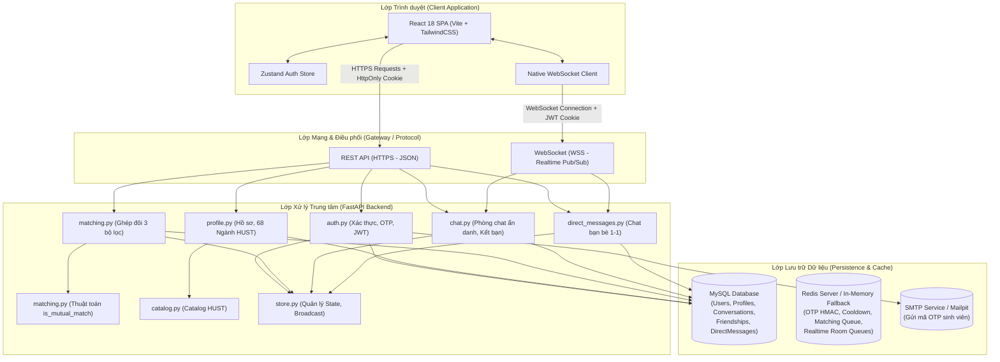
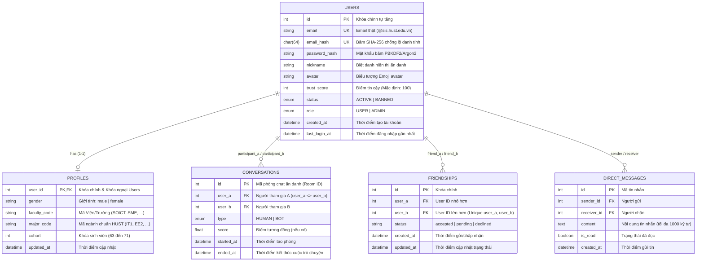
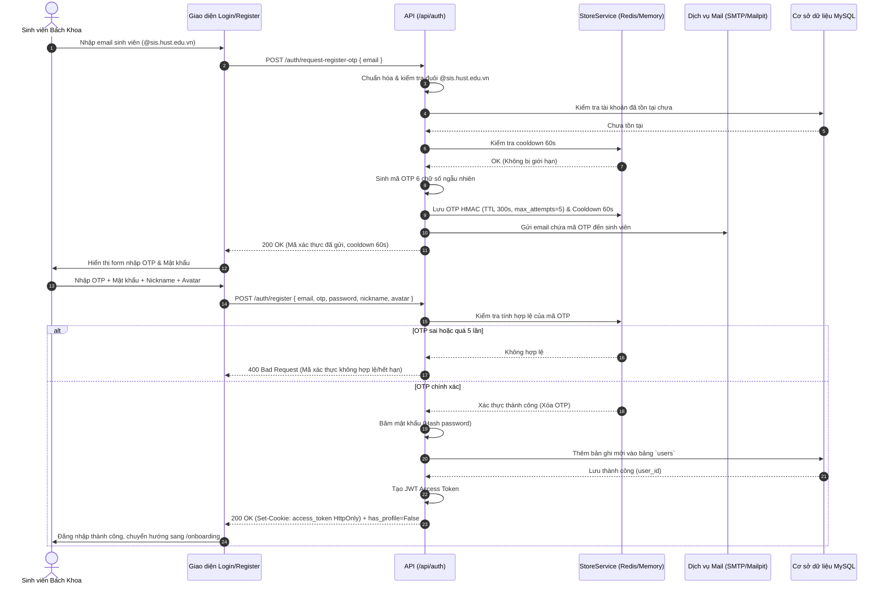
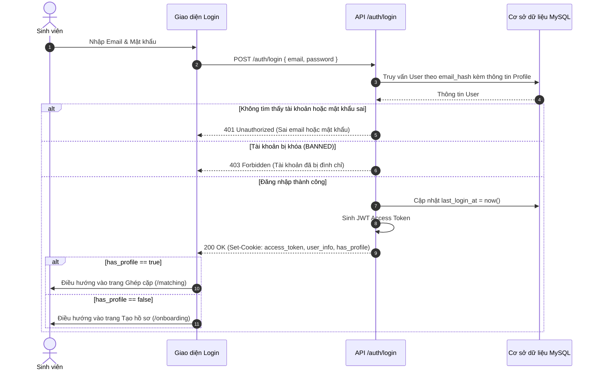
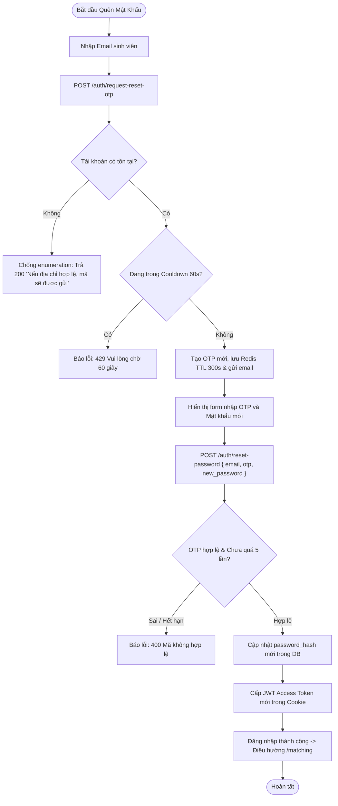
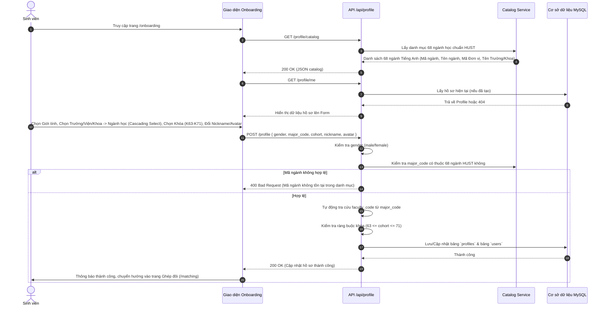
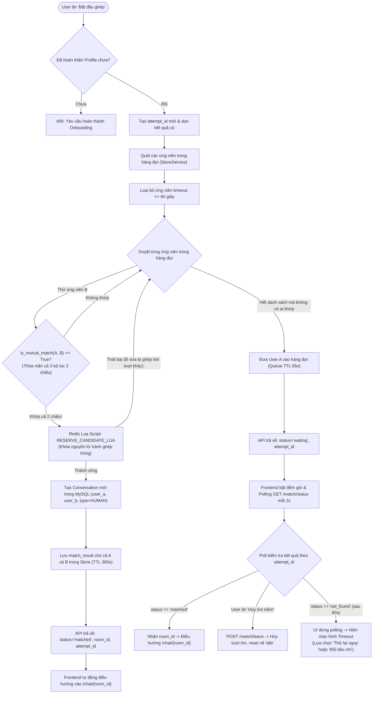
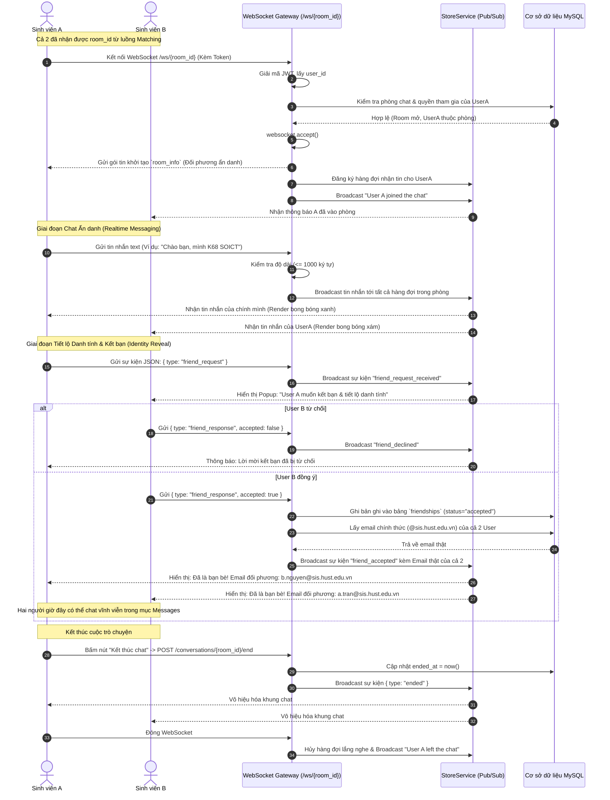
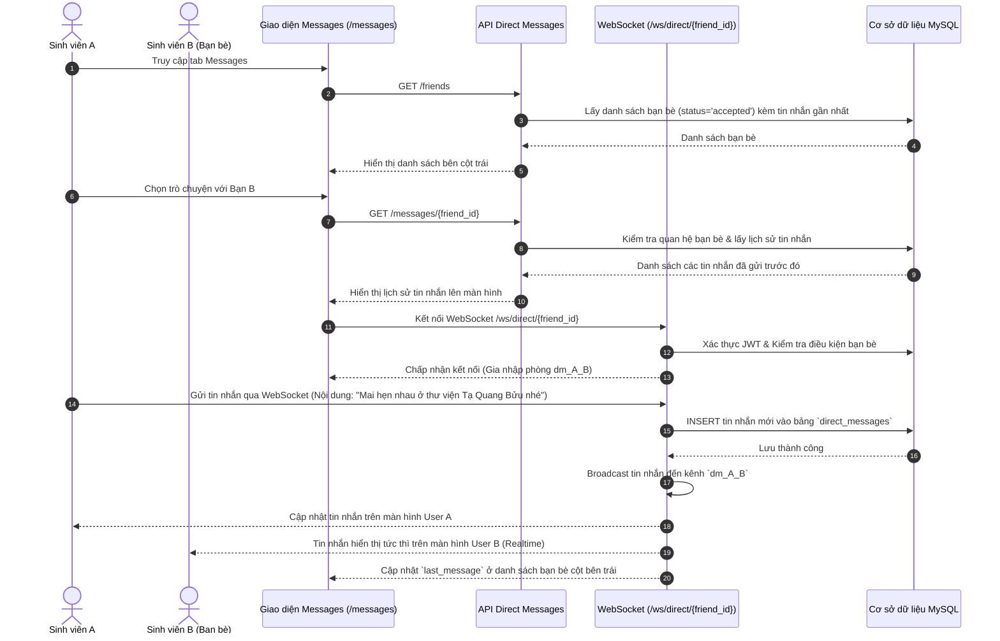
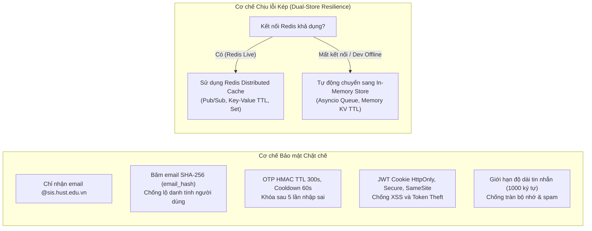

# TÀI LIỆU PHÂN TÍCH TOÀN BỘ LUỒNG HOẠT ĐỘNG VÀ BIỂU ĐỒ HỆ THỐNG HUST CHATBOX

> **Dự án:** HUST Chatbox - Nền tảng kết nối & chat ẩn danh 1-1 cho sinh viên Đại học Bách Khoa Hà Nội  
> **Ngôn ngữ & Công nghệ:** FastAPI, Python 3.12+, React 18, Vite, TailwindCSS, SQLAlchemy (Async), MySQL, Redis / In-Memory Fallback, WebSocket  
> **Ngày phân tích:** 27/10/2026  
> **Tài liệu nguồn kiểm chứng:** Toàn bộ mã nguồn `backend/` và `frontend/` trong kho dự án.

---

## MỤC LỤC
1. [Tổng quan Kiến trúc Hệ thống (System Architecture)](#1-tổng-quan-kiến-trúc-hệ-thống)
2. [Sơ đồ Thực thể Cơ sở Dữ liệu (Database ERD)](#2-sơ-đồ-thực-thể-cơ-sở-dữ-liệu-erd)
3. [Luồng 1: Xác thực & Quản lý Tài khoản (Authentication Flow)](#3-luồng-1-xác-thực--quản-lý-tài-khoản)
   - 3.1. Đăng ký tài khoản với Email OTP
   - 3.2. Đăng nhập Email & Mật khẩu
   - 3.3. Quên mật khẩu & Đặt lại mật khẩu (Reset Password)
   - 3.4. Khôi phục phiên làm việc (Session Restore & /me)
   - 3.5. Đăng xuất (Sign Out)
4. [Luồng 2: Khai báo & Quản lý Hồ sơ (Profile & Onboarding Flow)](#4-luồng-2-khai-báo--quản-lý-hồ-sơ)
   - 4.1. Tải danh mục 68 ngành học & 10 Viện/Trường HUST
   - 4.2. Khai báo hồ sơ sinh viên (Giới tính, Ngành, Khóa K63-K71, Nickname, Avatar)
5. [Luồng 3: Ghép cặp Ẩn danh theo 3 Bộ lọc Cứng Hai Chiều (Matching Flow)](#5-luồng-3-ghép-cặp-ẩn-danh-theo-3-bộ-lọc-cứng-hai-chiều)
   - 5.1. Cơ chế 3 bộ lọc cứng hai chiều (is_mutual_match)
   - 5.2. Luồng tức thì (Instant Match) vs. Luồng chờ hàng đợi (Queue & Polling)
6. [Luồng 4: Phòng Chat Realtime Ẩn danh & Tiết lộ Danh tính (Realtime Anonymous Chat)](#6-luồng-4-phòng-chat-realtime-ẩn-danh--tiết-lộ-danh-tính)
   - 6.1. Bắt tay WebSocket, xác thực JWT & kiểm tra tư cách thành viên
   - 6.2. Trao đổi tin nhắn văn bản ẩn danh
   - 6.3. Luồng kết bạn & Tiết lộ danh tính (Friend Request & Identity Reveal)
   - 6.4. Kết thúc phòng chat & Ngắt kết nối
7. [Luồng 5: Nhắn tin Trực tiếp giữa Bạn bè (Direct Messaging Flow)](#7-luồng-5-nhắn-tin-trực-tiếp-giữa-bạn-bè)
   - 7.1. Danh sách bạn bè & hội thoại gần nhất
   - 7.2. Kênh WebSocket nhắn tin trực tiếp riêng (Direct Message WS)
8. [Bảng Tra cứu API Endpoints & WebSocket Routes](#8-bảng-tra-cứu-api-endpoints--websocket-routes)
9. [Cơ chế Bảo mật, Khả năng Chịu lỗi & Fallback Tự động](#9-cơ-chế-bảo-mật-khả-năng-chịu-lỗi--fallback-tự-động)

---

## 1. TỔNG QUAN KIẾN TRÚC HỆ THỐNG

Hệ thống được thiết kế theo mô hình **Client-Server kiến trúc hiện đại**, phân tách rõ ràng giữa Single Page Application (SPA Frontend) và API Server không trạng thái (Stateless Backend), kết hợp cơ chế Stateful Realtime qua WebSocket và Bộ lưu trữ kép (Dual Store: Redis hoặc In-memory Fallback).

---

## 2. SƠ ĐỒ THỰC THỂ CƠ SỞ DỮ LIỆU (DATABASE ERD)

Cơ sở dữ liệu quan hệ được xây dựng chặt chẽ với các ràng buộc khóa ngoại, chỉ mục hiệu năng cao và các kiểu dữ liệu Enum.

---

## 3. LUỒNG 1: XÁC THỰC & QUẢN LÝ TÀI KHOẢN

### 3.1. Luồng Đăng ký Tài khoản (Registration with OTP)
1. **Kiểm tra đầu vào:** Email phải đúng định dạng sinh viên Đại học Bách Khoa Hà Nội (`@sis.hust.edu.vn`).
2. **Kiểm tra trùng lặp & Cooldown:** Backend kiểm tra email hoặc băm email `email_hash` trong DB. Đồng thời kiểm tra Cooldown (60 giây) qua `store_service.is_in_cooldown`.
3. **Sinh & Lưu trữ OTP:** Sinh mã OTP 6 số ngẫu nhiên qua module `secrets`, băm HMAC-SHA256 lưu vào Redis/Store với TTL 300 giây (5 phút), giới hạn tối đa 5 lần thử sai.
4. **Gửi Mail:** Gửi qua giao thức SMTP đến hòm thư sinh viên (trong môi trường dev sử dụng Mailpit hoặc in log).
5. **Xác thực mã & Khởi tạo tài khoản:** Người dùng nhập OTP + Mật khẩu mới (tối thiểu 6 ký tự) + Nickname + Avatar tùy chọn. Backend kiểm tra OTP, băm mật khẩu, tạo bản ghi `User`, cấp phát JWT token được đóng gói trong HttpOnly Cookie (`access_token`).

---

### 3.2. Luồng Đăng nhập (Password Login)
Người dùng nhập email sinh viên và mật khẩu. Hệ thống kiểm tra mật khẩu đã băm, kiểm tra trạng thái tài khoản không bị khóa (`status != BANNED`), cập nhật `last_login_at` và trả về JWT Cookie. Nếu người dùng chưa hoàn thành hồ sơ (`has_profile == false`), hệ thống điều hướng vào `/onboarding`. Nếu đã hoàn thành hồ sơ, hệ thống đưa vào `/matching`.

---

### 3.3. Luồng Quên Mật khẩu (Password Reset Flow)
Bao gồm 2 bước:
1. `POST /api/auth/request-reset-otp`: Kiểm tra email tồn tại trong hệ thống -> Lưu mã OTP và gửi về email.
2. `POST /api/auth/reset-password`: Xác minh mã OTP hợp lệ -> Cập nhật mật khẩu mới vào cơ sở dữ liệu -> Tự động đăng nhập luôn (cấp JWT cookie).

---

### 3.4. Luồng Khôi phục Phiên làm việc & Đăng xuất
- Khi người dùng truy cập bất kỳ trang nào (F5 trình duyệt), `App.jsx` gọi `GET /api/auth/me`.
- Backend kiểm tra cookie `access_token`. Nếu hợp lệ, trả về user info và profile; nếu không, tự động làm sạch store Zustand.
- Khi người dùng bấm **Sign Out**, gửi `POST /api/auth/logout`. Backend xóa cookie và Client xóa bộ nhớ, chuyển về `/login`.

---

## 4. LUỒNG 2: KHAI BÁO & QUẢN LÝ HỒ SƠ (ONBOARDING)

Mỗi sinh viên bắt buộc phải hoàn thành hồ sơ trước khi có thể tham gia tìm bạn chat.

---

## 5. LUỒNG 3: GHÉP CẶP ẨN DANH THEO 3 BỘ LỌC CỨNG HAI CHIỀU

Đây là hạt nhân nghiệp vụ của ứng dụng, đảm bảo tính thỏa mãn song phương (Bipartite Mutual Satisfaction).

### 5.1. Quy tắc 3 Bộ lọc Cứng Hai Chiều (`is_mutual_match`)

Một cặp ghép giữa Sinh viên A và Sinh viên B chỉ được coi là thành công khi và chỉ khi:
$$\text{is\_mutual\_match}(A, B) = \text{Accepts}(A \to B) \land \text{Accepts}(B \to A)$$

| Tiêu chí | Lựa chọn lọc của User A | Điều kiện để chấp nhận User B |
|---|---|---|
| **Giới tính** (`target_gender`) | `any` (Bất kì) `male` (Nam) `female` (Nữ) | Không kiểm tra `B.gender == 'male'` `B.gender == 'female'` |
| **Ngành / Viện** (`target_major_faculty`) | `any` (Bất kì) `same_major` (Cùng ngành) `same_faculty` (Cùng trường/viện khác ngành) `different_faculty` (Khác trường/viện) | Không kiểm tra `A.major_code == B.major_code` `A.faculty_code == B.faculty_code` VÀ `A.major_code != B.major_code` `A.faculty_code != B.faculty_code` |
| **Khóa học** (`target_cohort`) | `any` (Bất kì) `same_cohort` (Cùng khóa) `senior` (Khóa trên) `junior` (Khóa dưới) | Không kiểm tra `A.cohort == B.cohort` `B.cohort < A.cohort` (Ví dụ A là K68 thì B là K67, K66...) `B.cohort > A.cohort` (Ví dụ A là K68 thì B là K69, K70...) |

### 5.2. Biểu đồ Luồng Tìm kiếm & Ghép cặp

---

## 6. LUỒNG 4: PHÒNG CHAT REALTIME ẨN DANH & TIẾT LỘ DANH TÍNH

### 6.1. Chi tiết Bắt tay WebSocket & Vòng đời Phòng Chat
1. **Bắt tay & Xác thực:** Client mở kết nối `wss://<host>/ws/{room_id}` kèm cookie JWT.
2. **Kiểm tra thành viên:** Backend kiểm tra `room_id` có tồn tại, `user_id` có phải `user_a` hoặc `user_b` không, và phòng chưa bị kết thúc (`ended_at IS NULL`).
3. **Đăng ký lắng nghe:** Client được gán một hàng đợi nhận tin riêng trong `StoreService._rooms[room_id]`.
4. **Broadcast tham gia:** Server gửi tin nhắn `room_info` tới client mới và broadcast `user joined` tới toàn phòng.

---

## 7. LUỒNG 5: NHẮN TIN TRỰC TIẾP GIỮA BẠN BÈ (DIRECT MESSAGES)

Sau khi hai sinh viên đã đồng ý kết bạn ở phòng chat ẩn danh, mối quan hệ bạn bè được lưu vĩnh viễn trong bảng `friendships`. Họ có thể trò chuyện bất cứ lúc nào qua giao diện **Messages**.

---

## 8. BẢNG TRA CỨU API ENDPOINTS & WEBSOCKET ROUTES

Toàn bộ các tuyến giao tiếp của hệ thống đều được bảo vệ và chuẩn hóa:

| Phương thức | Đường dẫn Route | Mục đích nghiệp vụ | Quyền truy cập |
|---|---|---|---|
| **GET** | `/health` | Kiểm tra tình trạng máy chủ (Healthcheck) | Công khai |
| **POST** | `/api/auth/request-register-otp` | Yêu cầu mã OTP đăng ký (Kiểm tra `@sis.hust.edu.vn`) | Công khai |
| **POST** | `/api/auth/register` | Xác thực OTP & Tạo tài khoản mới | Công khai |
| **POST** | `/api/auth/login` | Đăng nhập bằng Email & Mật khẩu | Công khai |
| **POST** | `/api/auth/request-reset-otp` | Yêu cầu mã OTP đặt lại mật khẩu | Công khai |
| **POST** | `/api/auth/reset-password` | Xác thực OTP & Đổi mật khẩu mới | Công khai |
| **GET** | `/api/auth/me` | Lấy thông tin tài khoản hiện tại & trạng thái hồ sơ | Đã đăng nhập (JWT) |
| **POST** | `/api/auth/logout` | Đăng xuất & Xóa cookie `access_token` | Đã đăng nhập (JWT) |
| **GET** | `/api/profile/catalog` | Lấy danh mục 68 ngành học & 10 Viện/Trường HUST | Công khai |
| **GET** | `/api/profile/me` | Lấy chi tiết hồ sơ cá nhân của người dùng | Đã đăng nhập (JWT) |
| **POST** | `/api/profile` | Tạo mới hoặc cập nhật hồ sơ sinh viên | Đã đăng nhập (JWT) |
| **POST** | `/api/match/join` | Tham gia hàng đợi ghép đôi với 3 bộ lọc cứng | Đã có hồ sơ |
| **GET** | `/api/match/status` | Polling kiểm tra trạng thái ghép cặp | Đã có hồ sơ |
| **POST** | `/api/match/leave` | Hủy tìm kiếm và rời khỏi hàng đợi | Đã đăng nhập (JWT) |
| **WS** | `/ws/{room_id}` | WebSocket chat ẩn danh 1-1 & Tiết lộ danh tính | Thành viên phòng |
| **POST** | `/api/conversations/{room_id}/end` | Kết thúc phòng trò chuyện ẩn danh | Thành viên phòng |
| **GET** | `/api/friends` | Lấy danh sách bạn bè đã kết bạn | Đã đăng nhập (JWT) |
| **GET** | `/api/messages/{friend_id}` | Lấy lịch sử tin nhắn trực tiếp với bạn bè | Là bạn bè |
| **POST** | `/api/messages/{friend_id}` | Gửi tin nhắn trực tiếp qua HTTP REST | Là bạn bè |
| **WS** | `/ws/direct/{friend_id}` | WebSocket chat trực tiếp realtime giữa bạn bè | Là bạn bè |

---

## 9. CƠ CHẾ BẢO MẬT, KHẢ NĂNG CHỊU LỖI & FALLBACK TỰ ĐỘNG

### Các nguyên tắc bảo mật cốt lõi:
1. **Quyền riêng tư tuyệt đối khi Chat Ẩn danh:**
   - Trong quá trình ghép cặp và chat tại phòng `/ws/{room_id}`, danh tính thật (Email, Họ tên thật) hoàn toàn được giấu kín. Hai bên chỉ nhìn thấy Nickname ảo, Avatar emoji, Giới tính, Khóa học và Ngành học.
   - Chỉ khi **cả hai bên cùng đồng ý** trong sự kiện "Reveal Identity / Friend Request", email sinh viên chính thức mới được tiết lộ.
2. **Bảo vệ chống Brute-Force & Lạm dụng:**
   - Rate limit gửi OTP: Cooldown 60 giây giữa mỗi lần bấm.
   - Thử sai tối đa 5 lần: Sau 5 lần nhập sai OTP, key OTP bị hủy ngay lập tức trên hệ thống lưu trữ.
3. **Kiểm tra phân quyền chặt chẽ ở Backend (Authorization Gates):**
   - Mọi WebSocket connection đều được giải mã JWT và truy vấn DB xác thực membership trước khi hàm `accept()` được gọi. Người lạ không thể nghe trộm hoặc gửi tin vào bất kỳ phòng nào.
4. **Không phụ thuộc cứng vào Redis:**
   - Hệ thống được trang bị lớp trừu tượng `StoreService` có khả năng tự động fallback về In-Memory an toàn nếu Redis gặp sự cố, đảm bảo dịch vụ không bị gián đoạn.

---
*Tài liệu được tổng hợp và phân tích trực tiếp từ mã nguồn thực tế của dự án HUST Chatbox.*
