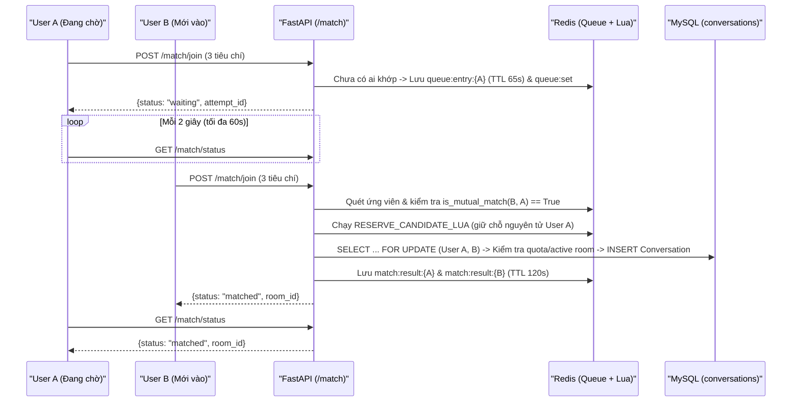

# Kịch bản 7 Luồng Nghiệp vụ Tuần tự (End-to-End System Flows)

Tài liệu này mô tả chi tiết 7 luồng chạy thực tế từ Frontend → Backend → MySQL/Redis của **HUST Match** (đã đồng bộ với kiến trúc ngày 03/11/2026). Để tra cứu danh sách bảng DB hoặc danh mục Redis Keys, xem `db/schema.md` và `docs/ARCHITECTURE.md`.

---

## Luồng 1: Đăng ký OTP, Đăng nhập & Quản lý Phiên (`jti`)

1. **Yêu cầu mã OTP (`POST /auth/request-register-otp`)**:
   - Kiểm tra hậu tố `@sis.hust.edu.vn` (`is_valid_hust_email`).
   - Kiểm tra rate-limit IP (`20 lần/60s`) và Email HMAC (`5 lần/300s`) cùng cooldown (`60s`).
   - **Chống dò tài khoản (Anti-Enumeration)**: Nếu email đã có `password_hash` trong bảng `users`, hệ thống đặt cooldown 60s và **trả về `200 OK` với thông báo chung** mà không gửi email.
   - Nếu hợp lệ: sinh OTP 6 số, băm HMAC với `purpose="register"`, lưu vào `hust:v1:otp:register:{email_hash}` (TTL 300s) và gửi email HTML qua `aiosmtplib`. Nếu gửi SMTP thất bại, xóa ngay key OTP vừa tạo.
2. **Hoàn tất đăng ký (`POST /auth/register`)**:
   - Đối chiếu OTP bằng `hmac.compare_digest` (tối đa 5 lần thử sai).
   - Băm mật khẩu bằng `PBKDF2-HMAC-SHA256` (260,000 vòng lặp + salt ngẫu nhiên), lưu bản ghi `users` (gồm cả `email`, `email_hash`, `password_hash`, `nickname`, `avatar`).
   - Sinh JWT chứa `sub` (`user.id`) và `jti` duy nhất; ghi `jti` vào Redis (`hust:v1:auth:session:{jti}`) và đính kèm cookie `access_token` (`HttpOnly`).
3. **Đặt lại mật khẩu (`POST /auth/reset-password`) & Đăng xuất (`POST /auth/logout`)**:
   - Đặt lại mật khẩu dùng domain OTP riêng (`purpose="reset"`). Ngay khi đổi mật khẩu thành công, gọi `revoke_user_sessions(user.id)` xóa toàn bộ `jti` cũ của user trên mọi thiết bị.

---

## Luồng 2: Thiết lập Hồ sơ & Danh mục 68 Ngành (`Onboarding`)

1. Khi mở `/onboarding`, Frontend khởi tạo sẵn danh mục từ fallback tĩnh `frontend/src/lib/hustCatalog.js`, đồng thời gọi `GET /profile/catalog` và `GET /profile/me`.
2. Backend đọc `db/seed/hust-68-nganh-2026.csv` bằng `encoding="utf-8-sig"` (tự động loại bỏ ký tự ẩn UTF-8 BOM `\ufeff`) và cache trong RAM qua `@lru_cache(maxsize=1)`.
3. Người dùng chọn **Trường/Viện/Khoa** → dropdown **Ngành đào tạo** tự động lọc danh sách ngành thuộc trường đó.
4. Khi gửi `POST /profile`: Backend tra cứu `major_code` trong catalog để tự gán `faculty_code` chuẩn (`VARCHAR(100)`), lưu vào bảng `profiles` và cập nhật `nickname`/`avatar` vào bảng `users`.

---

## Luồng 3: Ghép đôi 2 Chiều Nguyên tử & Timeout 60 Giây (`Matching`)

- **Kiểm tra phòng đang mở**: Khi vào `/matching`, Frontend gọi `GET /match/active-room`. Nếu user đang có cuộc trò chuyện chưa kết thúc (`ended_at IS NULL`), tự động điều hướng về `/chat/{room_id}`.
- **Hết 60 giây**: Nếu `now - joined_at >= 60`, ứng viên bị xóa khỏi hàng đợi và ghi nhận vào `hust:v1:match:terminal:{user_id}` để trả về `{status: "not_found"}`.

---

## Luồng 4: Khởi tạo Phòng Chat Ẩn danh, Reconnect 24h & Phân trang Cursor

1. **Khởi tạo 1 bước (`GET /conversations/{room_id}/init?limit=20`)**:
   - Thay vì gọi rời rạc `/meta` và `/history`, `Chat.jsx` gọi duy nhất `/init` để lấy thông tin đối phương (`opponent.email` luôn là `None`) cùng 20 tin nhắn gần nhất từ Redis (`hust:v1:chat:history:{room_id}`, TTL 24h) và cờ `has_more`.
2. **Kết nối WebSocket (`WS /ws/{room_id}`)**:
   - Frontend tạo URL qua `buildWsUrl(\`/ws/\${roomId}\`)` (đi qua proxy `/ws` của Vite khi chạy local).
   - Backend kiểm tra Origin → JWT & `jti` → **kiểm tra thành viên phòng & `conv.ended_at is None` trong MySQL** → mới gọi `acquire_ws_slot` (giới hạn 3 kết nối/user, 10 kết nối/IP).
   - Khi gửi tin nhắn: phát qua kênh `hust:v1:channel:match:{room_id}` và đẩy vào danh sách Redis `hust:v1:chat:history:{room_id}`.
3. **Hỗ trợ F5 / Mất mạng tạm thời**:
   - Khi 1 tab F5, khối `finally` gọi `unsubscribe_room` (chỉ gỡ queue của tab đó, **giữ nguyên task lắng nghe Redis Pub/Sub của phòng**) và trả lại WS slot (`release_ws_slot`). Khi tab kết nối lại, lịch sử 24h được tải lại từ `/init` và khử trùng lặp qua `msgKey`.
4. **Cuộn xem tin nhắn cũ (Infinite Scroll Up)**:
   - Khi cuộn lên đỉnh, `Chat.jsx` gọi `GET /conversations/{room_id}/history?limit=20&before_timestamp={earliest_ts}` và ghép vào đầu danh sách mà không bị giật vị trí cuộn.

---

## Luồng 5: Kết bạn 2 Chiều & Tự động Chuyển tiếp sang `/messages`

1. **Gửi lời mời (`{"type": "friend_request"}`)**:
   - Chuẩn hóa thứ tự `lower_id = min(u1, u2)`, `upper_id = max(u1, u2)` và khóa dòng `SELECT ... FOR UPDATE` trên bảng `friendships`.
   - **Trường hợp 1 (Chưa có lời mời)**: Lưu `status = "pending"`, `requested_by = sender_id` và phát sự kiện `friend_request_received` cho đối phương.
   - **Trường hợp 2 (Đối phương đã gửi lời mời trước đó — `requested_by == opp_id`)**: Tự động nâng lên `status = "accepted"` và kích hoạt `_transition_chat_to_dm()`.
   - **Trường hợp 3 (Hai người vốn đã là bạn bè từ lần ghép đôi trước — `status == "accepted"`)**: Kích hoạt ngay `_transition_chat_to_dm(already_friends=True)`.
2. **Phản hồi lời mời (`{"type": "friend_response", "accepted": true|false}`)**:
   - Kiểm tra `friendship.can_be_responded_to_by(responder_id=user_id, requester_id=opp_id)` (ngăn người gửi tự bấm chấp nhận).
3. **Chuyển tiếp sang Direct Messages (`_transition_chat_to_dm`)**:
   - Tự động đặt `conv.ended_at = func.now()` cho phòng ẩn danh trong MySQL.
   - Phát sự kiện `friend_accepted` (lúc này mới tiết lộ `email` thật của 2 bên và cờ `redirect_to_dm: true`), sau đó hủy Pub/Sub phòng ẩn danh sau 0.5s.
   - **Quy tắc bảo mật**: Tin nhắn trong phòng ẩn danh giữ nguyên tính tạm thời trên Redis, **không copy sang bảng `direct_messages`**.
   - Trên giao diện `Chat.jsx`, thanh thông báo xanh đếm ngược **2 giây** rồi tự động chuyển hướng sang `/messages?friendId={opponent.id}`.

---

## Luồng 6: Danh sách Bạn bè (Window Function) & Chat Bạn bè (`/ws/direct/{friend_id}`)

1. **Tải danh sách bạn bè (`GET /friends?limit=20&offset=0`)**:
   - Sử dụng **1 câu truy vấn SQL duy nhất** với Window Function `ROW_NUMBER() OVER (PARTITION BY partner_id ORDER BY created_at DESC)` để lấy thông tin bạn bè kèm nội dung và thời gian tin nhắn cuối cùng (khử hoàn toàn lỗi N+1 query).
2. **Tải lịch sử & Nhắn tin realtime (`/ws/direct/{friend_id}`)**:
   - Lịch sử tin nhắn tải qua `GET /messages/{friend_id}?limit=20&before_id={cursor}` (sắp xếp theo `DirectMessage.id`).
   - Kết nối WebSocket `/ws/direct/{friend_id}` kiểm tra `Friendship.status == "accepted"` **trước khi** gọi `acquire_ws_slot`.
   - Mọi tin nhắn bạn bè được gửi trực tiếp qua WebSocket này, lưu vĩnh viễn vào bảng `direct_messages` trong MySQL và phát qua kênh `hust:v1:channel:dm:{low_id}_{high_id}`.

---

## Luồng 7: Xử lý Sự cố Redis theo Môi trường (Fail-Fast 503 vs Dev Fallback)

- **Trên Production (`ENVIRONMENT=production`)**: Nếu Redis ngừng phản hồi ở bất kỳ thao tác nào trong `store.py`, `_handle_redis_failure` và `_ensure_redis_in_production` lập tức ném ngoại lệ `RedisUnavailable`. Exception handler tại `main.py` bắt ngoại lệ này và trả về **HTTP `503 Service Unavailable`** (tuyệt đối không fallback sang RAM để tránh sai lệch trạng thái giữa các worker).
- **Trên Local Development / Test (`ENVIRONMENT != production`)**: Tự động chuyển sang bộ nhớ đệm trong RAM (`_in_memory_*`) kèm khóa đồng bộ `_memory_lock` gắn theo từng `asyncio` event loop.
